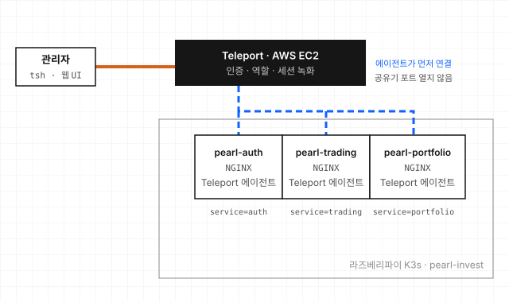

# Pearl Invest

홈랩의 라즈베리파이 K3s에서 도는 서비스에 관리자가 접근할 때, 직접 SSH나 kubeconfig를 쓰지 않고 Teleport를 거치게 만든 접근 제어 실습입니다. 누가 어느 서비스에 들어갈 수 있는지를 역할로 나누고, 접속 세션을 녹화해 다시 볼 수 있게 했습니다. (2024.09)

이 저장소는 첫 번째 구성(v1.0)입니다. 이후 장비 단위로 나눈 구성과 스마트공장 시뮬레이션으로 이어진 과정은 [프로젝트 소개](https://woosupar.dev/projects/pearl-invest/)에 있습니다. 관련 저장소:

- [Pearl-Invest-infra](https://github.com/grademe12/Pearl-Invest-infra): 다음 구성에서 쓴 Teleport와 K3s RBAC 설정
- [factory-OPCUA](https://github.com/grademe12/factory-OPCUA), [factory-monitoring](https://github.com/grademe12/factory-monitoring), [pearl_terraform](https://github.com/grademe12/pearl_terraform): 스마트공장 단계

## 구조



- 각 파드는 Debian 이미지 하나에 NGINX와 Teleport 에이전트를 supervisord로 함께 띄웁니다. 에이전트가 EC2의 Teleport에 먼저 연결하므로, 공유기에서 포트를 열지 않아도 밖에서 들어올 수 있습니다.
- 에이전트마다 `service` 라벨을 붙이고, Teleport 역할이 이 라벨로 접근 범위를 정합니다. 예를 들어 trader 역할은 `service=trading` 노드에만 들어갈 수 있습니다.

| 파일 | 내용 |
|---|---|
| `deployment.yaml` | v1.0 전체 구성. 네임스페이스, 공통 NGINX와 supervisord 설정, 서비스별 Teleport 설정(ConfigMap), Deployment 3개, NodePort Service |
| `pearl-auth/`, `pearl-trading/`, `pearl-portfolio/` | 접근 대상으로 쓴 FastAPI 데모 API와 각각의 Dockerfile, 매니페스트 |

## 써 보려면

### 접근 흐름 (Teleport가 준비된 상태에서)

```bash
tsh login --proxy=<teleport 주소> --user=<사용자>
tsh ls                          # 내 역할로 보이는 노드만 나옴
tsh ssh <로그인>@pearl-auth-node
tsh recordings ls               # 녹화된 세션
tsh play <세션 ID>
```

역할은 Teleport의 `role` 리소스에 `node_labels`로 정의합니다.

```yaml
kind: role
version: v7
metadata:
  name: trader
spec:
  allow:
    logins: [ubuntu]
    node_labels:
      service: trading
```

### 데모 API

세 API는 모두 FastAPI 앱이고 데이터는 메모리에만 있습니다. 재시작하면 처음 상태로 돌아갑니다.

| 서비스 | 포트 (컨테이너 / NodePort) | 주요 경로 |
|---|---|---|
| auth | 8080 / 30080 | `/auth/register`, `/auth/login`, `/user/profile`, `/admin/users` |
| trading | 8082 / 30081 | `/trading/order`, `/trading/orders`, `/trading/markets` |
| portfolio | 8081 / 30082 | `/portfolio/analysis`, `/portfolio/risk`, `/portfolio/rebalance` |

모두 `/health`와 Prometheus용 `/metrics`가 있습니다. 로컬에서 하나만 띄워 보려면:

```bash
cd pearl-auth
pip install -r requirements.txt     # Python 3.11 기준 버전 고정
uvicorn main:app --port 8080
curl -X POST localhost:8080/auth/register -H 'content-type: application/json' \
  -d '{"username":"demo","email":"demo@example.com","password":"demo-pass"}'
```

### 알아 둘 것

- **데모 API는 보안을 갖추지 않았습니다.** auth에는 평문 비밀번호로 된 예시 계정이 들어 있고, trading과 portfolio는 토큰 값을 검증하지 않고 아무 Bearer 토큰이나 받습니다. 접근 제어는 앱이 아니라 Teleport 계층에서 하는 것이 이 실습의 범위입니다.
- **`deployment.yaml`을 적용하려면 직접 만들 것이 있습니다.** NGINX와 Teleport 에이전트가 든 이미지(`pearl-invest/debian-slim:v2.0`)와, Teleport 참가 토큰을 담은 Secret(`teleport-join-token`)입니다. Teleport 주소도 자기 것으로 바꿔야 합니다.
- **이후 구성:** 파드 안에 에이전트를 넣는 이 방식은 서비스마다 이미지와 토큰을 관리해야 해서 번거로웠습니다. 다음 구성에서는 에이전트를 Helm으로 클러스터에 한 번 설치하고, 쿠버네티스 RBAC으로 권한을 나눴습니다([Pearl-Invest-infra](https://github.com/grademe12/Pearl-Invest-infra)).
